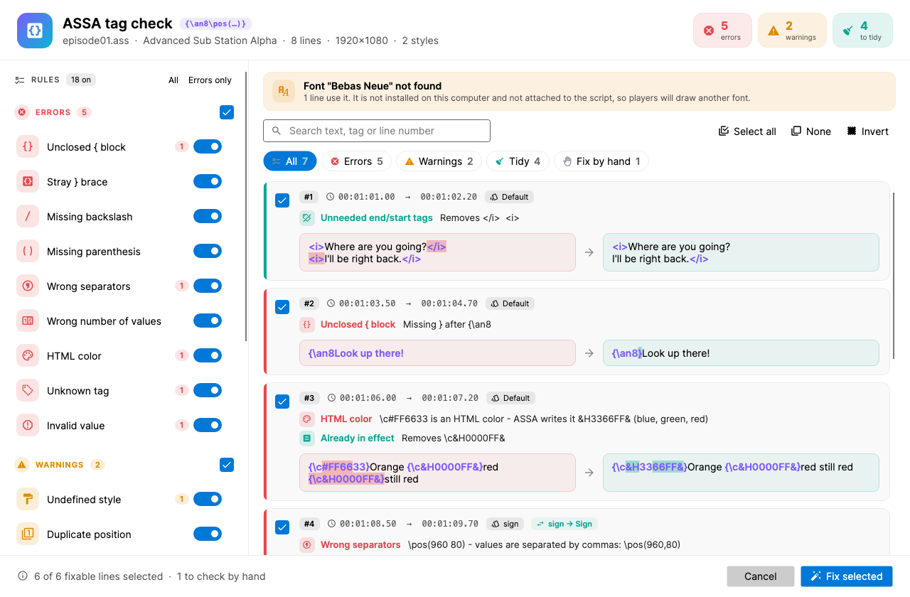

# ASSA tag check (Subtitle Edit 5 plugin)

Checks the override tags of an Advanced Sub Station Alpha subtitle, fixes what can be
fixed safely, and tidies tags that do nothing.

Built on Avalonia and the shared [`Plugin-Shared`](../Plugin-Shared/) library.

## Rules

Every rule can be turned off in the sidebar. Hover a rule for an example.

**Errors** - broken tags

| Rule | Example | Fixed to |
|---|---|---|
| Unclosed `{` block | `{\an8Look up!` | `{\an8}Look up!` |
| Stray `}` brace | `\an8}Look up!`, `{\an8}}Hi` | `{\an8}Look up!`, `{\an8}Hi` |
| Missing backslash | `{an8}`, `{/an8}` (a comment) | `{\an8}` |
| Missing parenthesis | `\pos(960,80`, `\pos960,80` | `\pos(960,80)` |
| Wrong separators | `\pos(960 80)`, `\pos(960;80)` | `\pos(960,80)` |
| Wrong number of values | `\move(0,0,960)` | shown only |
| HTML color | `\c#FF6633` | `\c&H3366FF&` |
| Unknown tag | `\I1` (case) / `\glow3` | `\i1` / removed |
| Invalid value | `\fsbig`, `\an0` | shown only |

**Warnings**

| Rule | What | Fix |
|---|---|---|
| Undefined style | The line or `\r` uses a style the script doesn't have | Same name in other case, else Default (`\r` resets) |
| Duplicate position | A second `\pos`/`\move`, `\an`, `\org` or `\fad` - only the first is used | Removed |
| Fade longer than line | `\fad(800,800)` on a 1 s line | Shortened, same proportions |
| Position off screen | `\pos` outside PlayResX x PlayResY | shown only |
| Font not found | A style or `\fn` font that is neither installed nor attached in `[Fonts]` | shown only |

**Tidy up** - tags that change nothing on screen

| Rule | Example | Becomes |
|---|---|---|
| Unneeded end/start tags | `<i>One</i> <i>line</i>`, `{\i0}{\i1}`, `<i>A<i>B</i>`, `{\i0}` when not italic | `<i>One line</i>`, ... |
| Changed before use | `{\fs40\fs60}Big` | `{\fs60}Big` |
| Already in effect | `{\c&H0000FF&}Red {\c&H0000FF&}red`, `{\fs48}` when the style is 48 | second tag removed |
| Empty block | `{}Hello` | `Hello` |
| Merge adjacent blocks | `{\an8}{\fs60}` | `{\an8\fs60}` |

The tidy rules follow the line's style and the tags before them, like a player does:
`{\i1}{\i0}` stays as `{\i0}` on an italic style, underline is not joined across a space,
and lines with `\t(...)` animations or `\p` drawings are left alone.

## UI

- Header counts lines with errors, warnings and tags to tidy.
- Filter by severity or "Fix by hand"; click a rule's count in the sidebar to see only its lines.
- Every line is a card with its problems and a colored before/after of the tags.
  Lines that can only be fixed by hand are listed without a checkbox.
- *Fix selected* applies the checked lines as one "ASSA tag check" undo step; style, actor,
  layer, margins and the other fields are kept.
- Turned-off rules and the scope (all / selected lines) are remembered.

## Build

See `.github/workflows/assa-tag-check.yml`.
