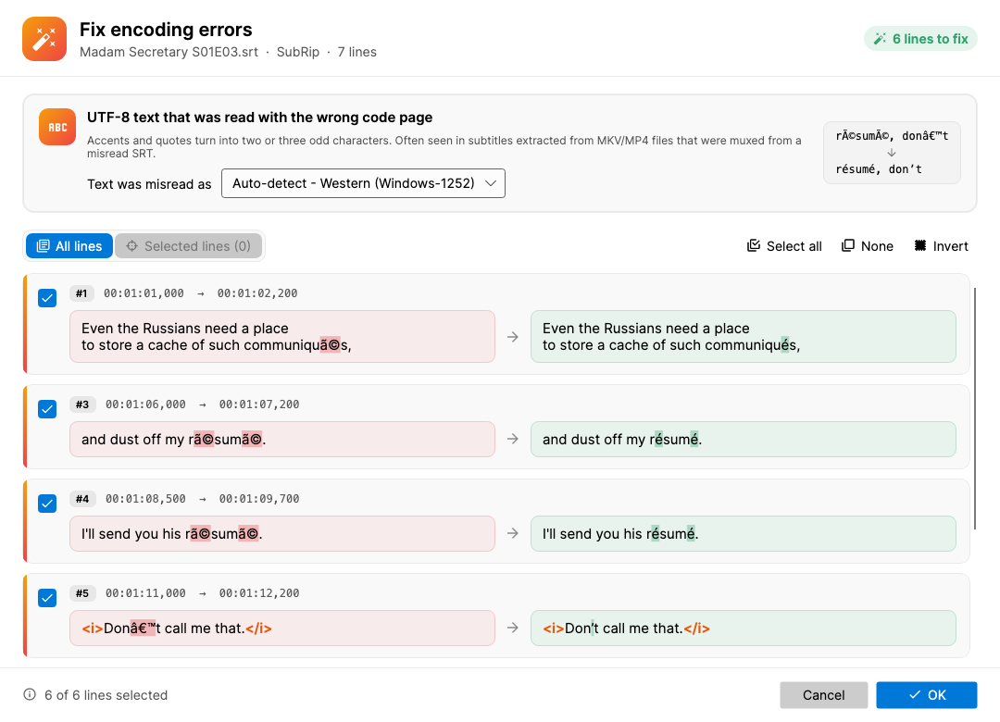

# Fix encoding errors (Subtitle Edit 5 plugin)

Repairs UTF-8 text that was read with the wrong code page and saved again
("mojibake"):

| Broken | Fixed |
|---|---|
| `résumé`, `communiqués` | `résumé`, `communiqués` |
| `don’t`, `“Hiâ€` | `don’t`, `“Hi”` |
| `25°`, `😀` | `25°`, `😀` |
| `rã©sumã©` (lowercased after it broke) | `résumé` |
| `Привет` (Western) / `Привет` (Cyrillic) | `Привет` |

Often seen in subtitles extracted from MKV/MP4 files: Matroska text tracks are
UTF-8, so a track muxed from an SRT that was misread somewhere along the way
keeps the broken characters, and Subtitle Edit shows exactly what is stored.

Built on Avalonia and the shared [`Plugin-Shared`](../Plugin-Shared/) library.

## How it works

Each character is mapped back to its byte in the code page the text was misread
with, and runs of bytes that form valid UTF-8 are decoded. Code pages:
Western (1252), Central European (1250), Cyrillic (1251), Greek (1253),
Turkish (1254) and Baltic (1257). *Auto-detect* picks the one with the most
clear matches.

Also handled:

- Text lowercased after it broke - `é` became `ã©`, so the lead byte is
  tried as its uppercase letter.
- A lost `0x9D` byte (undefined in Windows-1252): `â€` → `”`.
- A no-break space turned into a normal space: `Ã ` → `à`.
- A byte order mark read as text: `` is removed.
- Text broken twice (`é`) is fixed in more passes.

### Avoiding false fixes

- A two-character match must decode to a script the text could be in: Latin,
  plus Greek, Cyrillic, Hebrew and Arabic for Western (a Western PC misreads
  everything); Cyrillic for 1251 and Greek for 1253. So real Macedonian `ој`
  never turns into Greek `μ`.
- Matches ending in punctuation that can follow a real accented letter
  (`Não”`, `irmã…`, `«Não»`) are *ambiguous*. They are fixed only when the
  subtitle is clearly broken: it has unambiguous matches like `é` or `’`, and
  matches make up at least 30% of its non-ASCII characters.
- Three-byte matches that would decode to CJK are skipped; four-byte matches
  must be emoji.

Checked against all Subtitle Edit UI translations and word lists (about 360,000
lines in 35 languages): with *Auto-detect*, the only change was a line that
really is broken.

## UI

- *Text was misread as* - Auto-detect or a fixed code page; remembered.
- *All lines* / *Selected lines* - lines selected in Subtitle Edit are the
  default scope.
- Every changed line is a checkable before/after card with the changed
  characters highlighted. *OK* applies the checked lines as one
  "Fix encoding errors" undo step.

Works on the lines exactly as Subtitle Edit holds them, so styles, actors and
other fields of formats like ASSA are kept (falls back to SubRip on older SE
versions).

## Batch convert

Fix encoding errors supports Subtitle Edit's **Batch convert** (Tools → Batch convert → Run plugin; needs a Subtitle Edit version with plugin batch support).

- **Configure...** opens the window without a subtitle to pick the code page. *Auto-detect* (the default) checks each file on its own.
- During the batch every broken line is fixed without showing the window. Files with nothing to fix are left as they are. The same false-fix guards apply as in the window.

## Build

See `.github/workflows/fix-encoding-errors.yml`.
